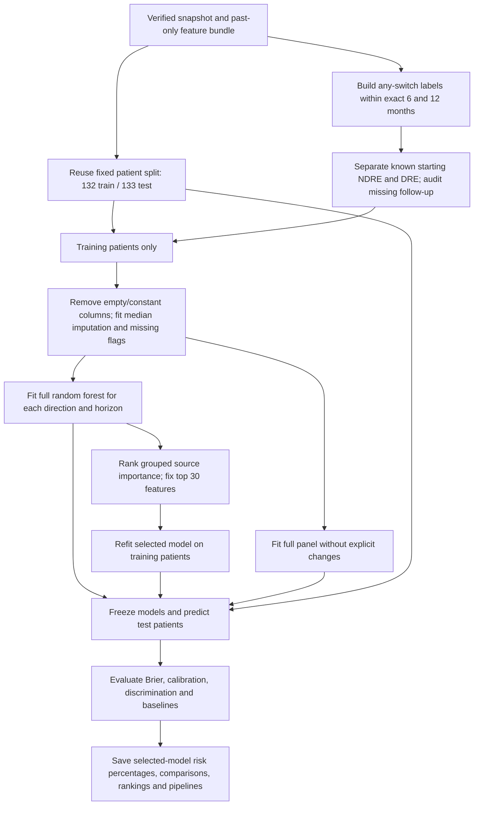

# Training protocol: probability of any observed monthly state switch

Updated 2026-10-17. Implemented in train.py, forest_workflow.py, and risk_targets.py.
This replaces the earlier endpoint-status protocol at the user's request.
Feature bundles retain the old endpoint audit columns, but training does not use those targets or weights.

## Prediction task

Predict immediately before each medication visit, using observations strictly before the visit from the preceding 12 months, including recent six-month summaries and changes. Include both starting states and histories with earlier switches. The original 83/182 final patient classification is not the outcome.

Use dbo.PatientMonthlyDreStatus.IsDRE from the verified snapshot. Starting state is the latest completed assessment strictly before prediction. An unknown latest assessment stays unknown; do not replace it with an older known state.

| Starting state | Positive outcome within 6/12 months | Reported risk |
|---|---|---|
| NDRE | At least one future DRE assessment | NDRE-to-DRE % |
| DRE | At least one future NDRE assessment | DRE-to-NDRE % |

A subsequent reversal does not erase a positive event. No-switch risk is 100% minus the applicable switch risk. The two direction columns are not complementary class probabilities; the nonapplicable direction is null.

Include assessments strictly after prediction and on/before its exact calendar-month anniversary. For January 15, the six-month cutoff is July 15; January 31 through June 30 are the expected assessments. This differs from the old endpoint rule extending to the month-end containing the anniversary.

- Any observed opposite state establishes a positive outcome, including when later assessments are missing or the full horizon has not elapsed.
- A negative requires every expected assessment to be known and the entire horizon to have elapsed by extraction. Other incomplete follow-up is unknown.
- Unknown starting states cannot define a directional task or receive a risk.
- Missing outcomes exclude rows only from the affected supervised task. Models can forecast those rows when the starting state is known.

This targets switches visible on the monthly grid. Transitions reversing between assessments cannot be identified. The stored rule uses rolling seizure history and medication snapshots; transitions are not independently adjudicated clinical outcomes. Informative missing follow-up can bias complete-outcome analysis; this initial classifier does not model censoring.

## Data and feature timing

Use the verified data/sql_snapshots/epilepsydb_20261016 snapshot and data/features/previsit_20261016_eeg_v1 bundle: 265 patients, 43,581 visits, and 1,027 candidate features. Verify manifest hashes, alignment, dictionary order, numeric values, and patient assignments. Training does not read the live database or update labels.

Candidate domains include medication substance/dose/DDD levels, last-two-visit changes, added/stopped drugs and substitutions, six/twelve-month regimen-change counts, interval-aware seizure summaries, laboratory/cognitive values and changes, EEG scores/presence/changes, examination timing, age, sex, history coverage, and prior monthly-state history. Patient IDs, future labels, outcome dates/reasons, and audit weights are not predictors.

Both visits supporting medication changes must be within the preceding year. Missing changes stay missing. Normalize drug aliases using existing audited rules. Do not add milligrams across substances. DailyDose is already mg/day; calculate DDD only with valid compatible values. Preserve extreme doses and source review flags without clipping. Gender is 1=male, 0=female.

Reuse the existing EEG report parser's ordinal scores plus presence/change indicators. Scores are not probabilities. Explicit negatives, normal reports, unknown findings, contradictory text, and review flags remain distinct. Availability uses the later of database and embedded report dates. Representative encodings require clinical review. Imaging clinical interpretation is not encoded.

Aggregate modalities independently before joining. Duplicate visit dates fail explicitly. Recording timestamps are not always available; historical availability remains an assumption where clinical dates serve as proxies. See FEATURE_BUILDING.md for detailed definitions.

## Fixed patient split and preprocessing

Reuse the saved seed-42 allocation: 132 training and 133 test patients. All visits and horizons follow each patient's assignment. No row-level split, cross-validation, repeated split, seed search, or extra validation partition. Report contributing patients per task because eligibility differs. Monthly-history strata were used for allocation only, not as future-history predictors.

Within each task and partition, each patient's eligible visits sum to weight one. Fit all-empty and truly constant exclusions on training rows only. Retain variable missingness even if observed values are constant. Fit median imputation and missingness indicators on training and reuse them unchanged on test data.

## Full-feature ranking and fixed top-30 models

The user specified all usable candidates followed by 30 selected source features per direction and horizon. The feature count was fixed before the comparison.

1. Fit a full forest on all usable training candidates.
2. Rank source features by training impurity importance, adding generated missingness-indicator importance to its source feature. Break ties by name. Include excluded candidates with zero score and a reason.
3. Keep the top 30 source features; refit preprocessing and the forest on the same training patients using only those columns.
4. Also fit the full panel excluding explicit temporal-change features to assess their contribution separately from subset selection.
5. Freeze these models before evaluating the corresponding test outcomes.

The selected model supplies the primary risk files regardless of test performance. Report every comparison; test results do not choose feature count, features, seed, settings, threshold, or primary model. Rankings are exploratory: impurity importance can favor some feature types, and correlated features divide credit. A single split does not establish selection stability, causality, or clinical importance. No test-set importance feeds selection.

## Forest settings and evaluation

Fixed settings: 500 trees, max_depth=8, min_samples_leaf=10, max_features='sqrt', class_weight=None, seed 42. Apply equal-patient sample weights. No hyperparameter search, downsampling, or ordinary row-level out-of-bag validation. Save four selected, four full, and four no-change comparison pipelines.

Report patient-weighted Brier score (primary; lower is better), log loss, ROC-AUC, average precision, calibration plots/diagnostic intercept and slope, and classification metrics at the fixed 0.5 threshold. Compare against the training-patient-weighted event fraction for the same starting state/horizon and a no-switch persistence baseline. Report event and eligible-patient counts.

Use 1,000 patient-cluster resamples of saved test predictions for Brier/log-loss intervals and paired Brier differences for the change-feature comparison. No forests are refitted and no training folds are introduced. These intervals do not capture all model-development uncertainty. Single-class AUC is unavailable.

Output raw forest estimates. Do not fit calibration on test outcomes or in-sample training predictions. Diagnostic calibration regressions describe test performance only and never alter forecasts. Independent 6/12-month forests can violate increasing risk with horizon; preserve and flag crossings instead of silently reordering.

This evaluates other patients from the same source population, not independent clinical or later-calendar-time validation. A later all-patient refit would be a separate model without a fresh independent test result from this dataset.

## Saved outputs

Choose a new results/ directory per run.

- report.md, metrics.json, calibration.png, roc.png.
- feature_importance.json: every candidate's training rank, grouped importance, missing-indicator contribution, selected status, and exclusion reason.
- selected_features.json, retained_features.json, models.json, and serialized pipelines under models/.
- switch_targets.jsonl: labels, starting states, expected/known assessments, first opposite assessment, follow-up cutoffs, and exclusion reasons.
- heldout_risk_predictions.jsonl: test-patient forecasts and outcome context.
- risk_predictions.jsonl: all visits, with training forecasts marked in-sample.
- patient_split.json and provenance.json: input/code hashes and versions.

## Flowchart

