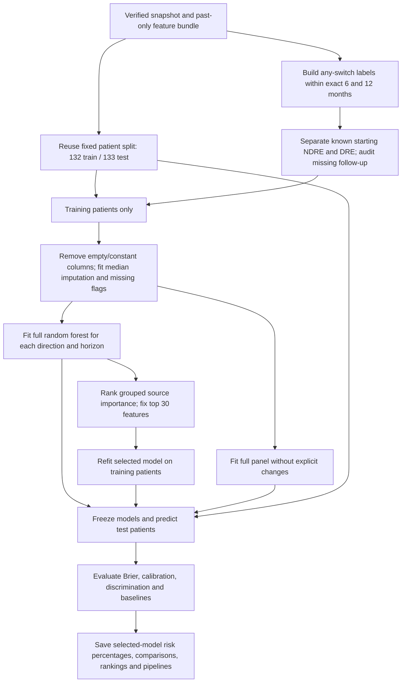

# Random forest training workflow and model performance

Prepared: **2026-10-17** (Asia/Taipei). Evaluated run: **rf_any_switch_20261017_all_top30_v1**, generated 2026-10-17T13:51:40.697639+08:00.

## Overview

Predict the probability of **any observed monthly switch** to the opposite DRE/NDRE state within 6 or 12 months. Use information available strictly before each medication visit. The database's monthly labels provide the reference standard; the original 83 DRE / 182 NDRE patient-level classification is not the training target.

The 265 patients were assigned once to 132 training and 133 test patients. Each of the four primary models uses its own 30 source features, selected using training data only. No cross-validation, model tuning, or test-driven feature-count selection was used.

On this saved test split, the top-30 models have lower Brier scores than their full-feature counterparts and the training-rate baseline in all four tasks. These descriptive differences do not establish improvement in another dataset. Risk percentages remain uncalibrated, and independent 6/12-month predictions can be inconsistent.

## Prediction dates and training eligibility

Create one row for **every valid medication visit date in AsmRecords.Date**, rather than one row per calendar month. Multiple visits in one month produce multiple prediction rows; a month without a medication visit has no prediction row. Invalid/future dates are excluded. Duplicate patient/date visits require reconciliation.

For a visit on date t, build features from [t minus 12 calendar months, t), including selected recent six-month summaries. Same-day visit information is excluded. Both visits supporting a medication change must fall within the preceding year.

**A complete 12 months of prior history is not required.** Short/sparse history remains eligible, with unavailable measurements and unsupported changes marked missing. A visit enters a particular training task only if its starting state is known and its 6- or 12-month outcome can be determined.

There are **43,581 candidate visit rows**: 21,132 from training patients and 22,449 from test patients, before task-specific exclusions. The 9,309 rows with unknown starting state receive no directional risk.

## Implemented training workflow

### Prediction task

Predict immediately before each medication visit, using observations strictly before the visit from the preceding 12 months, including recent six-month summaries and changes. Include both starting states and histories with earlier switches. The original 83/182 final patient classification is not the outcome.

Use dbo.PatientMonthlyDreStatus.IsDRE from the verified snapshot. Starting state is the latest completed assessment strictly before prediction. An unknown latest assessment stays unknown; do not replace it with an older known state.

| Starting state | Positive outcome within 6/12 months | Reported risk |
|---|---|---|
| NDRE | At least one future DRE assessment | NDRE-to-DRE % |
| DRE | At least one future NDRE assessment | DRE-to-NDRE % |

A subsequent reversal does not erase a positive event. No-switch risk is 100% minus the applicable switch risk. The two direction columns are not complementary class probabilities; the nonapplicable direction is null.

Include assessments strictly after prediction and on/before its exact calendar-month anniversary. For January 15, the six-month cutoff is July 15; January 31 through June 30 are the expected assessments. This differs from the old endpoint rule extending to the month-end containing the anniversary.

- Any observed opposite state establishes a positive outcome, including when later assessments are missing or the full horizon has not elapsed.
- A negative requires every expected assessment to be known and the entire horizon to have elapsed by extraction. Other incomplete follow-up is unknown.
- Unknown starting states cannot define a directional task or receive a risk.
- Missing outcomes exclude rows only from the affected supervised task. Models can forecast those rows when the starting state is known.

This targets switches visible on the monthly grid. Transitions reversing between assessments cannot be identified. The stored rule uses rolling seizure history and medication snapshots; transitions are not independently adjudicated clinical outcomes. Informative missing follow-up can bias complete-outcome analysis; this initial classifier does not model censoring.

### Data and feature timing

Use the verified data/sql_snapshots/epilepsydb_20261016 snapshot and data/features/previsit_20261016_eeg_v1 bundle: 265 patients, 43,581 visits, and 1,027 candidate features. Verify manifest hashes, alignment, dictionary order, numeric values, and patient assignments. Training does not read the live database or update labels.

Candidate domains include medication substance/dose/DDD levels, last-two-visit changes, added/stopped drugs and substitutions, six/twelve-month regimen-change counts, interval-aware seizure summaries, laboratory/cognitive values and changes, EEG scores/presence/changes, examination timing, age, sex, history coverage, and prior monthly-state history. Patient IDs, future labels, outcome dates/reasons, and audit weights are not predictors.

Both visits supporting medication changes must be within the preceding year. Missing changes stay missing. Normalize drug aliases using existing audited rules. Do not add milligrams across substances. DailyDose is already mg/day; calculate DDD only with valid compatible values. Preserve extreme doses and source review flags without clipping. Gender is 1=male, 0=female.

Reuse the existing EEG report parser's ordinal scores plus presence/change indicators. Scores are not probabilities. Explicit negatives, normal reports, unknown findings, contradictory text, and review flags remain distinct. Availability uses the later of database and embedded report dates. Representative encodings require clinical review. Imaging clinical interpretation is not encoded.

Aggregate modalities independently before joining. Duplicate visit dates fail explicitly. Recording timestamps are not always available; historical availability remains an assumption where clinical dates serve as proxies. See FEATURE_BUILDING.md for detailed definitions.

### Fixed patient split and preprocessing

Reuse the saved seed-42 allocation: 132 training and 133 test patients. All visits and horizons follow each patient's assignment. No row-level split, cross-validation, repeated split, seed search, or extra validation partition. Report contributing patients per task because eligibility differs. Monthly-history strata were used for allocation only, not as future-history predictors.

Within each task and partition, each patient's eligible visits sum to weight one. Fit all-empty and truly constant exclusions on training rows only. Retain variable missingness even if observed values are constant. Fit median imputation and missingness indicators on training and reuse them unchanged on test data.

### Full-feature ranking and fixed top-30 models

The user specified all usable candidates followed by 30 selected source features per direction and horizon. The feature count was fixed before the comparison.

1. Fit a full forest on all usable training candidates.
2. Rank source features by training impurity importance, adding generated missingness-indicator importance to its source feature. Break ties by name. Include excluded candidates with zero score and a reason.
3. Keep the top 30 source features; refit preprocessing and the forest on the same training patients using only those columns.
4. Also fit the full panel excluding explicit temporal-change features to assess their contribution separately from subset selection.
5. Freeze these models before evaluating the corresponding test outcomes.

The selected model supplies the primary risk files regardless of test performance. Report every comparison; test results do not choose feature count, features, seed, settings, threshold, or primary model. Rankings are exploratory: impurity importance can favor some feature types, and correlated features divide credit. A single split does not establish selection stability, causality, or clinical importance. No test-set importance feeds selection.

### Forest settings and evaluation

Fixed settings: 500 trees, max_depth=8, min_samples_leaf=10, max_features='sqrt', class_weight=None, seed 42. Apply equal-patient sample weights. No hyperparameter search, downsampling, or ordinary row-level out-of-bag validation. Save four selected, four full, and four no-change comparison pipelines.

Report patient-weighted Brier score (primary; lower is better), log loss, ROC-AUC, average precision, calibration plots/diagnostic intercept and slope, and classification metrics at the fixed 0.5 threshold. Compare against the training-patient-weighted event fraction for the same starting state/horizon and a no-switch persistence baseline. Report event and eligible-patient counts.

Use 1,000 patient-cluster resamples of saved test predictions for Brier/log-loss intervals and paired Brier differences for the change-feature comparison. No forests are refitted and no training folds are introduced. These intervals do not capture all model-development uncertainty. Single-class AUC is unavailable.

Output raw forest estimates. Do not fit calibration on test outcomes or in-sample training predictions. Diagnostic calibration regressions describe test performance only and never alter forecasts. Independent 6/12-month forests can violate increasing risk with horizon; preserve and flag crossings instead of silently reordering.

This evaluates other patients from the same source population, not independent clinical or later-calendar-time validation. A later all-patient refit would be a separate model without a fresh independent test result from this dataset.

### Flowchart



## Outcome availability and eligible cohorts

Unknown follow-up does not automatically mean no switch. An observed opposite state establishes a positive; a negative requires all expected monthly assessments and complete horizon follow-up.

| Target reason | 6-month visits | 12-month visits |
|---|---:|---:|
| opposite_observed | 1,922 | 3,485 |
| complete_no_opposite | 30,370 | 27,033 |
| incomplete_followup | 1,980 | 3,754 |
| unknown_starting_state | 9,309 | 9,309 |

Counts above cover all candidate visits. The following table applies direction, horizon, and split eligibility.

| Task | Train patients | Train visits | Train positive visits | Test patients | Test visits | Test positive visits |
|---|---:|---:|---:|---:|---:|---:|
| NDRE → DRE — 6 months | 117 | 12,794 | 470 | 123 | 14,084 | 521 |
| DRE → NDRE — 6 months | 63 | 2,698 | 435 | 64 | 2,716 | 496 |
| NDRE → DRE — 12 months | 116 | 12,184 | 812 | 123 | 13,361 | 903 |
| DRE → NDRE — 12 months | 62 | 2,496 | 837 | 63 | 2,477 | 933 |

Positive-visit counts are not counts of unique patients or independent transition episodes. Repeated visits can refer to overlapping future events. A patient can contribute different visits to both directions, so patient counts across tasks should not be added.

## Held-out model performance

All reported main metrics are **patient-weighted**: each patient's eligible visits receive total weight one within the relevant task and partition. The weighted event fraction therefore need not equal raw positive visits divided by all visits.

### Primary top-30 models

| Task | Test patients | Test visits | Observed switch % | RF Brier | Baseline Brier | RF ROC-AUC | RF average precision |
|---|---:|---:|---:|---:|---:|---:|---:|
| NDRE_to_DRE_6m | 123 | 14084 | 11.3 | 0.0794 | 0.1002 | 0.831 | 0.462 |
| DRE_to_NDRE_6m | 64 | 2716 | 30.2 | 0.1105 | 0.2107 | 0.891 | 0.810 |
| NDRE_to_DRE_12m | 123 | 13361 | 17.7 | 0.1163 | 0.1454 | 0.799 | 0.521 |
| DRE_to_NDRE_12m | 63 | 2477 | 56.2 | 0.2074 | 0.2499 | 0.770 | 0.801 |

RF columns above refer to the prespecified top-30 model. Brier is the primary probability score; lower is better. Metrics use equal total weight per patient. The state-only baseline uses the training-patient-weighted event fraction for the relevant starting state.

### Full versus selected features

| Task | Usable full features | Selected features | Full Brier | Selected Brier | Full ROC-AUC | Selected ROC-AUC |
|---|---:|---:|---:|---:|---:|---:|
| NDRE_to_DRE_6m | 707 | 30 | 0.0848 | 0.0794 | 0.840 | 0.831 |
| DRE_to_NDRE_6m | 625 | 30 | 0.1361 | 0.1105 | 0.895 | 0.891 |
| NDRE_to_DRE_12m | 697 | 30 | 0.1232 | 0.1163 | 0.785 | 0.799 |
| DRE_to_NDRE_12m | 619 | 30 | 0.2267 | 0.2074 | 0.714 | 0.770 |

The number of retained features was fixed before this comparison; test performance does not choose the feature count, ranking, or primary model.

### Effect of change features

| Task | Brier with changes | Brier without changes | Paired difference (with minus without) |
|---|---:|---:|---:|
| NDRE_to_DRE_6m | 0.0848 | 0.0858 | -0.0010 |
| DRE_to_NDRE_6m | 0.1361 | 0.1347 | 0.0014 |
| NDRE_to_DRE_12m | 0.1232 | 0.1250 | -0.0018 |
| DRE_to_NDRE_12m | 0.2267 | 0.2271 | -0.0004 |

Patient-cluster bootstrap intervals for Brier/log loss and paired Brier differences are in metrics.json. Bootstrap resamples saved test predictions only; no forests are refitted.

The top-30 model remains the primary model regardless of these comparisons. ROC-AUC does not improve in every task when reducing the panel, even though Brier scores improve on this split. No paired interval for the full-versus-selected difference was saved; do not treat its point difference as an established improvement.

### Probability scores and uncertainty

| Task | Brier 95% interval | Log loss | Log-loss 95% interval |
|---|---|---:|---|
| NDRE → DRE — 6 months | 0.0574 to 0.1034 | 0.2702 | 0.2046 to 0.3411 |
| DRE → NDRE — 6 months | 0.0726 to 0.1595 | 0.3737 | 0.2583 to 0.5293 |
| NDRE → DRE — 12 months | 0.0901 to 0.1483 | 0.3782 | 0.3019 to 0.4722 |
| DRE → NDRE — 12 months | 0.1773 to 0.2413 | 0.5983 | 0.5261 to 0.6782 |

These 1,000 patient-cluster resamples operate on saved test predictions, without forest refitting or training folds. They do not capture all model-development uncertainty.

### Paired comparison of explicit change features

| Task | Brier difference: with minus without changes | Paired 95% interval |
|---|---:|---|
| NDRE → DRE — 6 months | -0.0010 | -0.003572 to 0.001112 |
| DRE → NDRE — 6 months | 0.0014 | -0.001993 to 0.005487 |
| NDRE → DRE — 12 months | -0.0018 | -0.004128 to -0.000025 |
| DRE → NDRE — 12 months | -0.0004 | -0.004888 to 0.003807 |

Negative differences favor including changes. The 12-month NDRE-to-DRE interval is narrowly below zero; the other three include zero. These exploratory comparisons do not establish a general benefit from adding change features. This comparison uses the full panel versus that panel without explicit changes, not the selected model versus the no-change model.

### Calibration of the selected models

| Task | Mean predicted switch % | Observed weighted switch % | Diagnostic intercept | Diagnostic slope |
|---|---:|---:|---:|---:|
| NDRE → DRE — 6 months | 9.8 | 11.3 | 0.318 | 1.067 |
| DRE → NDRE — 6 months | 24.9 | 30.2 | 0.495 | 1.001 |
| NDRE → DRE — 12 months | 15.3 | 17.7 | 0.057 | 0.880 |
| DRE → NDRE — 12 months | 44.2 | 56.2 | 0.611 | 0.898 |

An intercept near zero and slope near one are desirable for the fitted diagnostic relationship. These regressions describe test performance only and do not recalibrate the forecasts. Mean predictions are below observed weighted event fractions in this run; calibration varies across risk ranges and tasks. Discrimination alone does not validate risk percentages.


### Classification at the fixed 50% threshold

| Task | Accuracy % | Sensitivity % | Specificity % | Precision % |
|---|---:|---:|---:|---:|
| NDRE → DRE — 6 months | 90.3 | 19.3 | 99.3 | 79.0 |
| DRE → NDRE — 6 months | 86.4 | 68.2 | 94.3 | 83.9 |
| NDRE → DRE — 12 months | 84.3 | 22.9 | 97.4 | 65.6 |
| DRE → NDRE — 12 months | 66.6 | 61.8 | 72.7 | 74.4 |

The threshold was not optimized on test outcomes. These summaries are secondary to probability performance; high accuracy can coexist with low sensitivity. Raw confusion matrices are saved in metrics.json.

## Risk interpretation and limitations

For starting NDRE, the applicable risk is NDRE-to-DRE; for starting DRE, it is DRE-to-NDRE. The other direction is null. No-switch percentage equals 100 minus the applicable switch percentage. These are conditional any-switch risks, not complementary probabilities of the two directions or endpoint class probabilities.

Known starting states can receive forecasts even if future outcomes are unavailable. Unknown starting states receive no directional risk. Training-patient forecasts are marked in-sample and should not be used to assess generalization.

- Monthly database labels are the reference standard, not independent clinical adjudication. Transitions reversing between monthly assessments cannot be detected.
- Visits and their overlapping history/follow-up windows remain correlated. Patient separation, equal-patient weighting, and clustered intervals address parts of this dependence without making each row independent.
- Available-outcome analysis can be biased by informative missing follow-up; this classifier does not model censoring.
- Clinical dates sometimes substitute for missing recording timestamps. Representative EEG encodings and preserved extreme doses still require source review.
- Impurity importance can favor some feature types and divide credit among correlated predictors. A single training split does not establish stable, causal, or clinically definitive importance.
- This is one split from one source population, without independent external or later-calendar-time validation. A later all-patient refit would be a separate model without a fresh independent test result.
- Independent 6/12-month forecasts can violate increasing risk with horizon; raw estimates are preserved and flagged rather than reordered.
  **1,673 of 17,895 test rows with known starting states (9.3%) are flagged**, with 2,917 flagged rows across both splits.

## Reproduction, checks, and saved artifacts

Run from the project root, choosing a new output directory:

```powershell
.\.venv\Scripts\python.exe "value based model/train.py" --train-forest --panel all --top-features 30 --output-dir "value based model/results/rf_NEW_RUN"
```

Recorded environment: Python 3.14.8; scikit-learn 1.8.0; pandas 3.0.2; NumPy 2.4.4. Input/code checksums and split assignments are saved for reproducibility.

The recorded implementation passed 53 local tests. Saved-model reload, probability ranges/complements, patient separation, hashes, selected-feature counts, and reproduction of saved test forecasts were checked after training. This combined document was assembled from saved artifacts without retraining or reselecting features.

- [Training entry point](<C:/Users/user/Desktop/Epilepsy/DRE_Prediction/value based model/train.py>), [Forest workflow](<C:/Users/user/Desktop/Epilepsy/DRE_Prediction/value based model/forest_workflow.py>), [Switch-target construction](<C:/Users/user/Desktop/Epilepsy/DRE_Prediction/value based model/risk_targets.py>).
- [Detailed feature definitions](<C:/Users/user/Desktop/Epilepsy/DRE_Prediction/value based model/FEATURE_BUILDING.md>).
- [Saved metrics](<C:/Users/user/Desktop/Epilepsy/DRE_Prediction/value based model/results/rf_any_switch_20261017_all_top30_v1/metrics.json>), [All candidate importance/exclusion records](<C:/Users/user/Desktop/Epilepsy/DRE_Prediction/value based model/results/rf_any_switch_20261017_all_top30_v1/feature_importance.json>).
- [Selected feature lists](<C:/Users/user/Desktop/Epilepsy/DRE_Prediction/value based model/results/rf_any_switch_20261017_all_top30_v1/selected_features.json>), [Retained and excluded model columns](<C:/Users/user/Desktop/Epilepsy/DRE_Prediction/value based model/results/rf_any_switch_20261017_all_top30_v1/retained_features.json>).
- [Test-patient risk percentages](<C:/Users/user/Desktop/Epilepsy/DRE_Prediction/value based model/results/rf_any_switch_20261017_all_top30_v1/heldout_risk_predictions.jsonl>), [All forecasts with training context marked](<C:/Users/user/Desktop/Epilepsy/DRE_Prediction/value based model/results/rf_any_switch_20261017_all_top30_v1/risk_predictions.jsonl>).
- [Any-switch labels and coverage audit](<C:/Users/user/Desktop/Epilepsy/DRE_Prediction/value based model/results/rf_any_switch_20261017_all_top30_v1/switch_targets.jsonl>).
- [Model registry](<C:/Users/user/Desktop/Epilepsy/DRE_Prediction/value based model/results/rf_any_switch_20261017_all_top30_v1/models.json>), [Patient assignments](<C:/Users/user/Desktop/Epilepsy/DRE_Prediction/value based model/results/rf_any_switch_20261017_all_top30_v1/patient_split.json>), [Input/code provenance](<C:/Users/user/Desktop/Epilepsy/DRE_Prediction/value based model/results/rf_any_switch_20261017_all_top30_v1/provenance.json>).

Patient-level artifacts remain local; this document reports aggregate results and feature names without listing patient identifiers.

## Appendix: 30 selected source features per task

Features follow the full training forest's selection rank. Grouped importance includes the source column and its generated missingness indicator. It is a share of total impurity reduction, **not a risk percentage**, and is not recomputed from the smaller forest.

### NDRE → DRE — 6 months

| Rank | Source feature | Grouped training importance % |
|---:|---|---:|
| 1 | `seizure_rate_lower_bound_per30d_6m` | 2.683 |
| 2 | `seizure_rate_lower_bound_per30d_12m` | 2.321 |
| 3 | `asm__phenobarbital_daily_mg` | 2.272 |
| 4 | `seizure_count_lower_bound_6m` | 2.152 |
| 5 | `seizure_count_lower_bound_12m` | 2.048 |
| 6 | `asm__phenobarbital_present` | 1.738 |
| 7 | `asm_dose_comparable_drugs` | 1.364 |
| 8 | `asm_drug_count_latest` | 1.175 |
| 9 | `history_days_available` | 1.129 |
| 10 | `monthly_positive_fraction_12m` | 1.078 |
| 11 | `biochem__ca_69590970__latest` | 1.066 |
| 12 | `biochem__egfr_ckd_epi_c86db1fe__latest` | 1.040 |
| 13 | `biochem__tg_mg_dl_ef68b78f__latest` | 1.033 |
| 14 | `asm_drug_count_lower_bound` | 1.028 |
| 15 | `biochem__uric_f89a5f4d__latest` | 1.007 |
| 16 | `monthly_observed_switches_12m` | 1.006 |
| 17 | `asm__lamotrigine_daily_mg` | 1.005 |
| 18 | `asm_total_ddd_latest` | 0.974 |
| 19 | `biochem__alb_g_dl_8abaff41__age_days` | 0.966 |
| 20 | `biochem__na_3d9fc4bd__latest` | 0.916 |
| 21 | `seizure_recent_vs_earlier_6m_rate_delta` | 0.913 |
| 22 | `hematology__mcv_32602d92__latest` | 0.904 |
| 23 | `asm__levetiracetam_daily_mg` | 0.845 |
| 24 | `seizure_coverage_fraction_12m` | 0.763 |
| 25 | `asm_assessable_pairs_12m` | 0.760 |
| 26 | `asm__levetiracetam_present` | 0.756 |
| 27 | `hematology__rbc_10_3_ul_f49f9fa3__latest` | 0.671 |
| 28 | `hematology__mpv_fl_c539ee5c__age_days` | 0.667 |
| 29 | `biochem__vitb12_efa8c832__age_days` | 0.662 |
| 30 | `asm_visits_12m` | 0.652 |

### DRE → NDRE — 6 months

| Rank | Source feature | Grouped training importance % |
|---:|---|---:|
| 1 | `seizure_zero_days_6m` | 9.335 |
| 2 | `seizure_count_lower_bound_6m` | 7.833 |
| 3 | `seizure_rate_lower_bound_per30d_6m` | 6.841 |
| 4 | `seizure_recent_vs_earlier_6m_rate_delta` | 4.312 |
| 5 | `seizure_zero_days_12m` | 2.997 |
| 6 | `seizure_count_lower_bound_12m` | 2.715 |
| 7 | `seizure_rate_lower_bound_per30d_12m` | 2.527 |
| 8 | `asm_days_since_last_observed_composition_change` | 1.971 |
| 9 | `monthly_positive_fraction_12m` | 1.713 |
| 10 | `age_years` | 1.512 |
| 11 | `asm__levetiracetam_daily_mg` | 1.262 |
| 12 | `brain_image_latest_age_days` | 1.232 |
| 13 | `monthly_observed_switches_12m` | 1.061 |
| 14 | `history_days_available` | 1.044 |
| 15 | `asm_drug_count_latest` | 1.033 |
| 16 | `asm_drug_count_lower_bound` | 1.018 |
| 17 | `seizure_coverage_fraction_12m` | 1.014 |
| 18 | `seizure_coverage_fraction_6m` | 1.001 |
| 19 | `asm_dose_comparable_drugs` | 0.970 |
| 20 | `asm_total_ddd_latest` | 0.958 |
| 21 | `seizure_known_days_12m` | 0.932 |
| 22 | `seizure_partial_positive_intervals_6m` | 0.872 |
| 23 | `seizure_known_days_6m` | 0.788 |
| 24 | `eeg_latest_age_days` | 0.746 |
| 25 | `seizure_earlier_6m_coverage_fraction` | 0.694 |
| 26 | `biochem__crea_mg_dl_6aa986e0__latest` | 0.674 |
| 27 | `asm_composition_changes_12m` | 0.627 |
| 28 | `eeg_encoded_latest_report_age_days` | 0.622 |
| 29 | `biochem__crea_mg_dl_6aa986e0__age_days` | 0.528 |
| 30 | `biochem__egfr_dd762d60__age_days` | 0.498 |

### NDRE → DRE — 12 months

| Rank | Source feature | Grouped training importance % |
|---:|---|---:|
| 1 | `seizure_rate_lower_bound_per30d_12m` | 2.668 |
| 2 | `seizure_count_lower_bound_12m` | 2.513 |
| 3 | `seizure_rate_lower_bound_per30d_6m` | 2.511 |
| 4 | `asm_total_ddd_latest` | 2.216 |
| 5 | `history_days_available` | 2.149 |
| 6 | `seizure_count_lower_bound_6m` | 1.998 |
| 7 | `asm_dose_comparable_drugs` | 1.911 |
| 8 | `asm_drug_count_lower_bound` | 1.733 |
| 9 | `asm__levetiracetam_daily_mg` | 1.703 |
| 10 | `asm__phenobarbital_present` | 1.561 |
| 11 | `monthly_positive_fraction_12m` | 1.541 |
| 12 | `asm_drug_count_latest` | 1.356 |
| 13 | `asm__phenobarbital_daily_mg` | 1.306 |
| 14 | `hematology__mcv_32602d92__latest` | 1.239 |
| 15 | `monthly_observed_switches_12m` | 1.225 |
| 16 | `biochem__egfr_ckd_epi_c86db1fe__age_days` | 1.202 |
| 17 | `hematology__rbc_10_3_ul_f49f9fa3__latest` | 1.062 |
| 18 | `asm_days_since_last_observed_composition_change` | 1.025 |
| 19 | `biochem__crea_mg_dl_6aa986e0__latest` | 0.989 |
| 20 | `asm__levetiracetam_present` | 0.979 |
| 21 | `asm__lamotrigine_daily_mg` | 0.970 |
| 22 | `sex_male` | 0.964 |
| 23 | `brain_image_latest_age_days` | 0.827 |
| 24 | `hematology__mch_pg_11da0fc9__latest` | 0.800 |
| 25 | `asm_composition_changes_12m` | 0.792 |
| 26 | `age_years` | 0.773 |
| 27 | `seizure_known_days_12m` | 0.756 |
| 28 | `biochem__egfr_ckd_epi_c86db1fe__latest` | 0.713 |
| 29 | `seizure_recent_vs_earlier_6m_rate_delta` | 0.682 |
| 30 | `seizure_zero_days_6m` | 0.632 |

### DRE → NDRE — 12 months

| Rank | Source feature | Grouped training importance % |
|---:|---|---:|
| 1 | `seizure_zero_days_6m` | 4.252 |
| 2 | `seizure_count_lower_bound_6m` | 4.137 |
| 3 | `seizure_zero_days_12m` | 4.122 |
| 4 | `seizure_rate_lower_bound_per30d_12m` | 3.685 |
| 5 | `seizure_count_lower_bound_12m` | 3.561 |
| 6 | `seizure_rate_lower_bound_per30d_6m` | 3.318 |
| 7 | `monthly_positive_fraction_12m` | 2.323 |
| 8 | `history_days_available` | 2.163 |
| 9 | `monthly_observed_switches_12m` | 1.835 |
| 10 | `age_years` | 1.805 |
| 11 | `asm_drug_count_latest` | 1.661 |
| 12 | `seizure_known_days_12m` | 1.639 |
| 13 | `asm_drug_count_lower_bound` | 1.613 |
| 14 | `seizure_recent_vs_earlier_6m_rate_delta` | 1.509 |
| 15 | `asm__levetiracetam_daily_mg` | 1.466 |
| 16 | `seizure_coverage_fraction_12m` | 1.367 |
| 17 | `asm_total_ddd_latest` | 1.345 |
| 18 | `asm__lamotrigine_daily_mg` | 1.254 |
| 19 | `biochem__crea_mg_dl_6aa986e0__latest` | 1.001 |
| 20 | `asm_dose_comparable_drugs` | 0.975 |
| 21 | `seizure_earlier_6m_coverage_fraction` | 0.964 |
| 22 | `eeg__spike_ed__latest_score` | 0.929 |
| 23 | `asm__perampanel_daily_mg` | 0.861 |
| 24 | `seizure_unknown_intervals_12m` | 0.810 |
| 25 | `seizure_coverage_fraction_6m` | 0.769 |
| 26 | `biochem__egfr_dd762d60__latest` | 0.746 |
| 27 | `asm__lamotrigine_present` | 0.697 |
| 28 | `biochem__egfr_dd762d60__age_days` | 0.656 |
| 29 | `biochem__alt_u_l_91de6add__latest` | 0.594 |
| 30 | `asm_days_since_last_observed_composition_change` | 0.584 |
